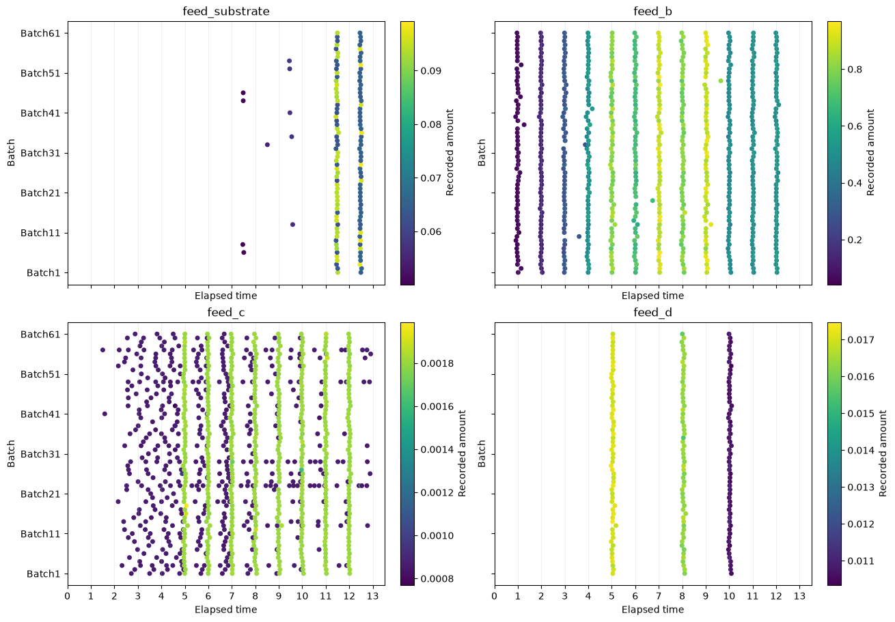

# Decode the Bioreactor

Predicting cell growth, substrate concentration, and byproduct formation from initial conditions and bioreactor operating data.

## 1. The Challenge

Given initial measurements and a known bioreactor operating trajectory, predict four quantities over time:

- **VCD** — Viable Cell Density
- **TCD** — Total Cell Density
- **Substrate** — Nutrient concentration
- **Byproduct** — Metabolic byproduct concentration

Our dataset contains 49 labeled training batches and 12 hidden test batches. Model performance is evaluated using Mean Absolute Percentage Error (MAPE).

## 2. Exploratory Data Analysis

### 2.1. What does a typical behaviour run look like?

Here are the four quantities we need to predict - plotting all known batches and the mean trajectory. Note that they are all densities, i.e., quantity per volume:

And here are the 4 feeds over time, the color indicated the amount:

### 2.2. How much do batches differ?

**[Figure 2: Target trajectories across all training batches]**

Overlay trajectories from different batches to identify common patterns and batch-to-batch variability.

Consider highlighting unusual late-stage behavior.

### 2.3. Does increasing volume explain declining cell density?

**[Figure 3: Cell density versus estimated total cell amount]**

Compare VCD and TCD with their volume-adjusted equivalents (VCD × volume and TCD × volume).

Investigate whether late-stage decreases in cell density reflect dilution, changes in total cell count, or both.

### 2.4. Where are the difficult prediction regions?

**[Figure 4: Prediction error by time step and target]**

Show cross-validated MAPE across the 13 prediction steps. Identify whether errors grow over time or concentrate in particular targets.

## 3. Key Insights

### 3.1. Reactor operations reveal hidden biological information

Feed-controller decisions encode information about substrate concentrations. Certain feeding actions are triggered by threshold crossings, providing indirect observations even when actual substrate measurements are unavailable.

**[Illustration: Substrate trajectory, controller thresholds, and corresponding feed events]**

### 3.2. Operating signals can reveal batch-specific behavior

Feed schedule deviations, unusual feeding events, and changes in volume provide useful information beyond initial conditions.

In particular, volume changes not explained by the raw feed measurements can act as empirical proxies for process activity, although feed mass-to-volume conversion is not explicitly known.

**[Illustration: Recorded volume changes versus feed-derived proxy]**

### 3.3. Time points are related — especially with limited training data

Rather than fitting 13 completely independent regressions, we use temporally regularized models that encourage neighboring prediction steps to share information.

This reduces sensitivity to noise while allowing the process dynamics to change over time.

**[Illustration: Independent Ridge versus fused Ridge coefficient trajectories]**

### 3.4. Different targets require different modeling strategies

Cell densities, substrate, and byproduct respond differently to operating conditions.

We therefore combine target-specific feature engineering with suitable regression methods, including robust fused Ridge, gradient boosting, and RBF-SVR.

For substrate, we additionally condition predictions on inferred controller constraints.

**[Illustration: Simplified model architecture]**

## 4. Modeling Approach

Our final approach combines:

- Initial conditions and engineered feeding/volume features.
- Temporally regularized and robust regression.
- Nonlinear regression for complementary predictions.
- Controller-informed substrate inference.
- Target-specific model blending.

**[Figure 5: Model pipeline diagram]**

## 5. Results

**[Table: Cross-validation MAPE by target, plus overall MAPE]**

**[Figure 6: Actual versus predicted trajectories for selected validation batches]**

Briefly discuss model strengths, remaining difficulties, and performance on the hidden test set, if available.

## 6. Limitations and Lessons Learned

- Small dataset: only 49 independent labeled batches.
- Some mechanistic quantities are available only through normalized measurements or empirical proxies.
- Late-stage metabolite predictions remain challenging.
- Repeated model selection on the same cross-validation data can lead to optimistic performance estimates.

## 7. How to Run

**[Instructions for environment setup, model execution, cross-validation, and generating submission files]**

## 8. Team and Acknowledgments

**[Team members, hackathon, and relevant references]**
