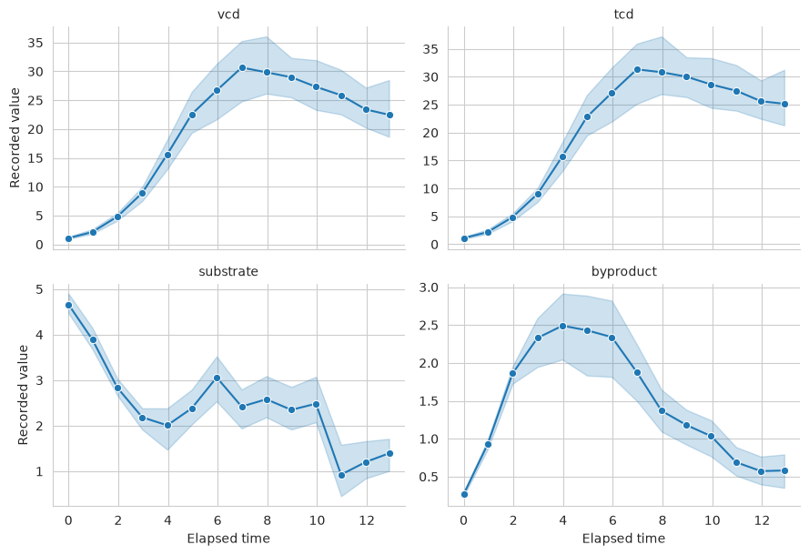
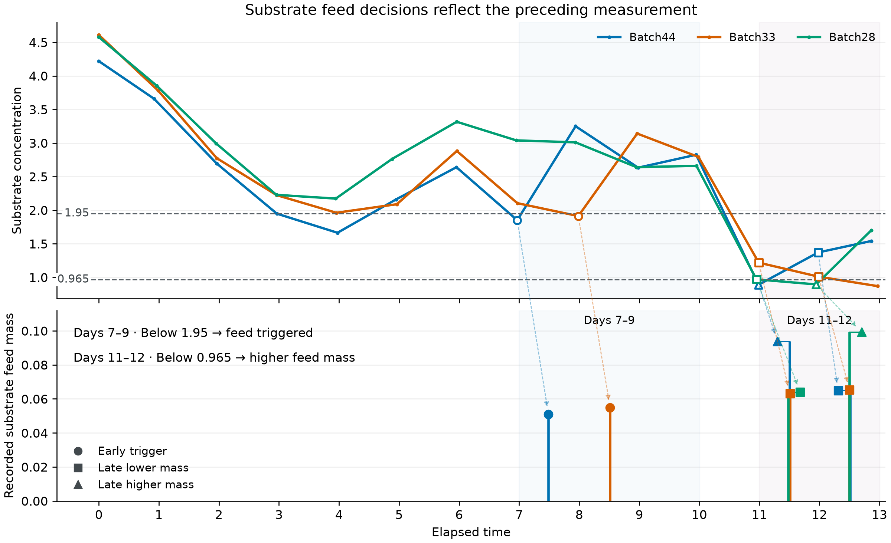

# Decode the Bioreactor

Predicting cell growth, substrate concentration, and byproduct formation from initial conditions and bioreactor operating data.

## 1. The Challenge

Given initial measurements and a known bioreactor operating trajectory, predict four quantities over time:

- **VCD** — Viable Cell Density
- **TCD** — Total Cell Density
- **Substrate** — Nutrient concentration
- **Byproduct** — Metabolic byproduct concentration

Our dataset contains 49 labeled training batches and 12 hidden test batches. Model performance is evaluated using Mean Absolute Percentage Error (MAPE).

## 2. Exploratory Data Analysis

### 2.1. What does a typical behaviour run look like?

Here are the four quantities we need to predict - plotting all known batches and the mean trajectory. Note that they are all densities, i.e., quantity per volume:

Note that the batch variability is relatively small early on and becomes more pronounced later, especially for cell densities. This suggests that differences between batches become more important as the process progresses.

And here are the 4 feeds over time, the color indicated the amount:

### 2.2. Does increasing volume explain declining cell density?

Comparing VCD and TCD with their volume-adjusted equivalents (VCD × volume and TCD × volume).

The volume steadily increases, which suggests that dilution can explain at least part of the decrease of VCD and TCD. (But does it explain everything?)

### 2.3. Where are the difficult prediction regions?

In this version, errors in Substrate and Byproduct increase over time, while the VCD and TCD are more stable.

## 3. Insights and Ideas

### 3.1. Reactor operations reveal biological information

The substrate feeding schedule appears to encode information about the underlying substrate concentration. By examining the relationship between measured substrate levels and subsequent feeding decisions, we identified two consistent controller rules:

Days 7–9: Substrate feeding is triggered when the concentration falls below approximately 1.95 (112/112 checked decisions consistent).

Days 11–12: A higher feed mass is administered when the concentration falls below approximately 0.965 (78/78 checked decisions consistent).

Feed events consistently follow the corresponding measurements by approximately 0.51–0.56 elapsed-time units.

These observations effectively turn the feeding schedule into an indirect substrate sensor. We incorporate the inferred threshold constraints into our predictions, allowing us to recover information about substrate concentrations even when the measurements themselves are hidden.

We don't observe substrate concentrations in test batches, but the controller's feeding decisions tell us whether they crossed certain thresholds.

### 3.2. Operating signals can reveal batch-specific behavior

Beyond substrate-controller decisions, the reactor's operating records contain additional information about batch behavior.

In particular, we identified an empirical volume–feed residual signal, derived from changes in reactor volume and recorded feeding quantities. During the early stages (steps 1–5), this signal showed a strong association with byproduct accumulation across batches (Pearson (r = 0.71), adjusted for timing and initial volume). The association remained substantial after additionally accounting for volume change ((r = 0.59)).

Interestingly, the signal was much less informative about short-term byproduct changes within individual batches. This suggests that it primarily captures batch-to-batch differences in process behavior, rather than instantaneous production rates.

Since feeds are recorded as masses rather than volumes, the residual is treated as an empirical predictor, not a physically exact volume balance.

### 3.3. Time points are related — especially with limited training data

With only 49 labeled batches, fitting independent regression models for each prediction step can lead to noisy estimates. Since the underlying biological process evolves continuously, we expect the relationships between inputs and outputs to change gradually over time.

We therefore tried fused Ridge regression, allowing each time step to have its own coefficients while encouraging neighboring steps to have similar coefficients. This shares information across time without imposing a fixed trajectory shape.

We also apply robust regression to reduce the influence of unusually large deviations in a few training batches.

### 3.4. Different targets require different modeling strategies

The four target variables exhibit different dynamics and respond differently to reactor operating conditions. 
Rather than using a single model for all targets, we suggest target-specific prediction strategies, here is a possible strategy-list (used in one of our latest attempts, v14):

VCD and TCD: Robust fused Ridge regression combined with nonlinear RBF-SVR and gradient boosting.

Substrate: Step-wise Ridge regression, supplemented by mass-balance-derived features and probabilistic conditioning on inferred feed-controller thresholds.

Byproduct: Robust fused Ridge combined with gradient boosting, using additional features derived from feeding patterns and volume changes.

This approach combines physically motivated feature engineering, temporal regularization, and nonlinear regression, while allowing each target to benefit from the information most relevant to its behavior.

## 4. Modeling Approach

Our final approach combines:

- Initial conditions and engineered feeding/volume features.
- Temporally regularized and robust regression.
- Nonlinear regression for complementary predictions.
- Controller-informed substrate inference.
- Target-specific model blending.

**[Figure 5: Model pipeline diagram]**

## 5. Results

Our latest (for when updating the Readme!) version achieved:
vcd mape: 6.535
tcd mape: 6.439
substrate mape: 6.512
byproduct mape: 7.687
mean mape: 6.793

## 6. Limitations and Lessons Learned

- Small dataset: only 49 independent labeled batches.
- Some mechanistic quantities are available only through normalized measurements or empirical proxies.
- Late-stage metabolite predictions remain challenging.
- Repeated model selection on the same cross-validation data can lead to optimistic performance estimates.

## 7. How to Run

**[Instructions for environment setup, model execution, cross-validation, and generating submission files]**

## 8. Team and Acknowledgments
Team members:
Gülce Berfin Ercan, Hümay Zehra Özer, Svetlana Tsizin, Karina Samvelyan.
